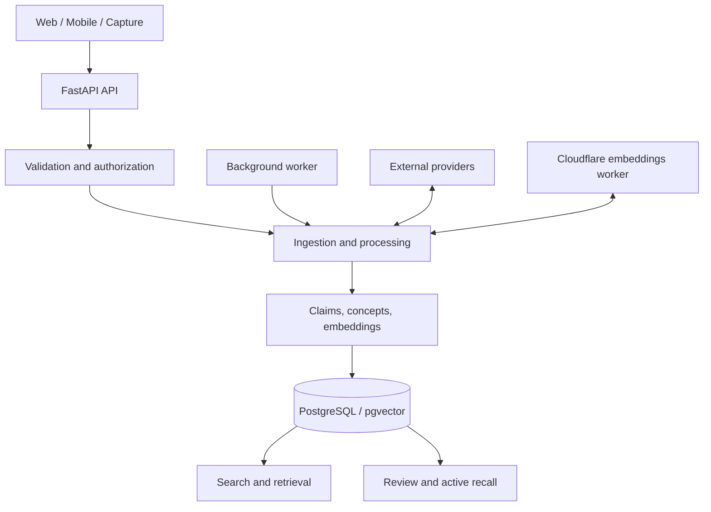

<p align="center">
  <strong>A personal knowledge OS for research, connected thinking, and durable recall.</strong><br/>
  Capture information → preserve evidence → connect concepts → retrieve and remember what matters.
</p>

<p align="center">
  <a href="https://cognix-nexus.vercel.app">Live Web App</a>
  &nbsp;·&nbsp;
  <a href="https://cognix-core-ypak.onrender.com">Backend API</a>
  &nbsp;·&nbsp;
  <a href="https://github.com/cognixnexus/Cognix-Nexus/issues">Issues</a>
  &nbsp;·&nbsp;
  <a href="docs/ARCHITECTURE.md">Architecture</a>
</p>

<p align="center">
  <a href="https://github.com/cognixnexus/Cognix-Nexus/actions/workflows/ci.yml"></a>
  <a href="https://github.com/cognixnexus/Cognix-Nexus/actions/workflows/codeql.yml"></a>
  <a href="https://github.com/cognixnexus/Cognix-Nexus/actions/workflows/production-ci.yml"></a>
</p>

<p align="center">
  
  
  
  
  
</p>

---

## Overview

**Cognix Nexus** is an evolving personal knowledge and research intelligence platform within the broader **Cognix Core** vision.

It is designed to turn scattered information into a structured, connected knowledge base. Sources can be captured and processed into claims, evidence, and concepts; reviewed knowledge can then support search, synthesis, graph exploration, and active recall.

> **Core idea:** Don't just save information. Make it understandable, traceable, connected, and reusable.

## Product capabilities

| Capability | Purpose |
|---|---|
| Research ingestion | Bring in research material from web sources, PDFs, audio, books, and capture channels |
| Evidence-first processing | Associate extracted claims with source material and review context |
| Knowledge graph | Explore relationships between concepts, citations, and evidence |
| Hybrid retrieval | Combine vector search and structured context |
| Active recall | Support durable learning with flashcards and spaced repetition |
| Multi-channel capture | Support web, mobile, cloud-drive, and Telegram-oriented workflows |
| Media intelligence | Process audio/video inputs and attach useful context |

Extracted information is not automatically verified knowledge. Source traceability and human review remain important.

## Architecture



This is a conceptual overview. See [Architecture Guide](docs/ARCHITECTURE.md) for repository boundaries, trust boundaries, and configuration guidance.

## Repository structure

```text
.
├── apps/
│   ├── mobile/                         # Expo / React Native client
│   └── web-platform/
│       ├── backend/                    # FastAPI API, workers, migrations, tests
│       ├── cloudflare/embeddings-worker # Cloudflare Worker
│       └── frontend/                   # Next.js web application
├── docs/                               # Architecture and engineering docs
├── scripts/                            # Production migration and verification
├── .github/workflows/                  # CI, release checks, CodeQL
├── render.yaml                         # Render services and configuration
├── SECURITY.md
└── CONTRIBUTING.md
```

## Technology

| Layer | Technologies |
|---|---|
| Web | Next.js 15, React, TypeScript |
| Backend | Python 3.12, FastAPI |
| Mobile | React Native, Expo |
| Database & retrieval | Supabase, PostgreSQL, pgvector |
| AI integrations | Gemini, Groq, and configured provider adapters |
| Edge processing | Cloudflare Workers |
| Media | Cloudinary and configured object storage |
| Deployment | Vercel, Render |

The stack reflects the current project configuration. Refer to source and deployment files for the authoritative details.

## Getting started

### Requirements

- Node.js 20+ and npm
- Python 3.12
- PostgreSQL with pgvector for database-backed local workflows
- Provider credentials only for integrations you intend to exercise

### Backend API

```bash
cd apps/web-platform/backend
python -m venv .venv

# macOS / Linux
source .venv/bin/activate

# Windows PowerShell
# .venv\\Scripts\\Activate.ps1

python -m pip install -r requirements.txt
uvicorn app.main:app --reload --port 8000
```

API docs are available at `http://localhost:8000/docs` when the API is running.

### Web application

Open a second terminal:

```bash
cd apps/web-platform/frontend
npm ci
npm run dev
```

The frontend development script uses port `3002` by default.

### Mobile application

```bash
cd apps/mobile
npm ci
npm run typecheck
npm run start
```

### Cloudflare embeddings worker

```bash
cd apps/web-platform/cloudflare/embeddings-worker
npm install
npm test
npm run dev
```

Configure worker secrets using Wrangler's secret management. Never commit secret values.

## Environment and secrets

Use the closest `.env.example` for each application. Configure required values before enabling connected providers.

- Keep credentials in local environment files or hosting-provider secret managers.
- Treat `NEXT_PUBLIC_*` and `EXPO_PUBLIC_*` variables as public client configuration.
- Never put service-role keys, OAuth refresh tokens, or provider secrets in frontend/mobile bundles.
- Never commit API keys, tokens, private documents, or user data.

## Quality and security

The repository includes automated workflows for frontend, backend, mobile, worker, dependency, CodeQL, and production-readiness checks. The badges above link to live workflow status; a workflow definition by itself is not evidence of a passing run.

- [Security Policy](SECURITY.md)
- [Contribution Guide](CONTRIBUTING.md)
- [Architecture Guide](docs/ARCHITECTURE.md)
- [GitHub Actions](https://github.com/cognixnexus/Cognix-Nexus/actions)

## Deployment

- **Web:** [cognix-nexus.vercel.app](https://cognix-nexus.vercel.app)
- **API:** [cognix-core-ypak.onrender.com](https://cognix-core-ypak.onrender.com)
- **Worker runtime:** configured in [render.yaml](render.yaml)

Hosted availability and feature coverage can change; check live services and deployment configuration for current status.

## Contributing

Bug reports and focused suggestions are welcome. Read [CONTRIBUTING.md](CONTRIBUTING.md) before proposing code changes. Use the issue forms for reproducible bug reports and feature requests. Do not publish vulnerability details in public issues; follow [SECURITY.md](SECURITY.md).

## License

The project currently states **Private Knowledge OS License — All Rights Reserved**. This is a proprietary project; public repository visibility does not grant permission to redistribute or reuse source code.

---

<p align="center">
  <sub>COGNIX CORE · CONNECTED INTELLIGENCE · BUILT FOR KNOWLEDGE THAT COMPOUNDS</sub>
</p>
