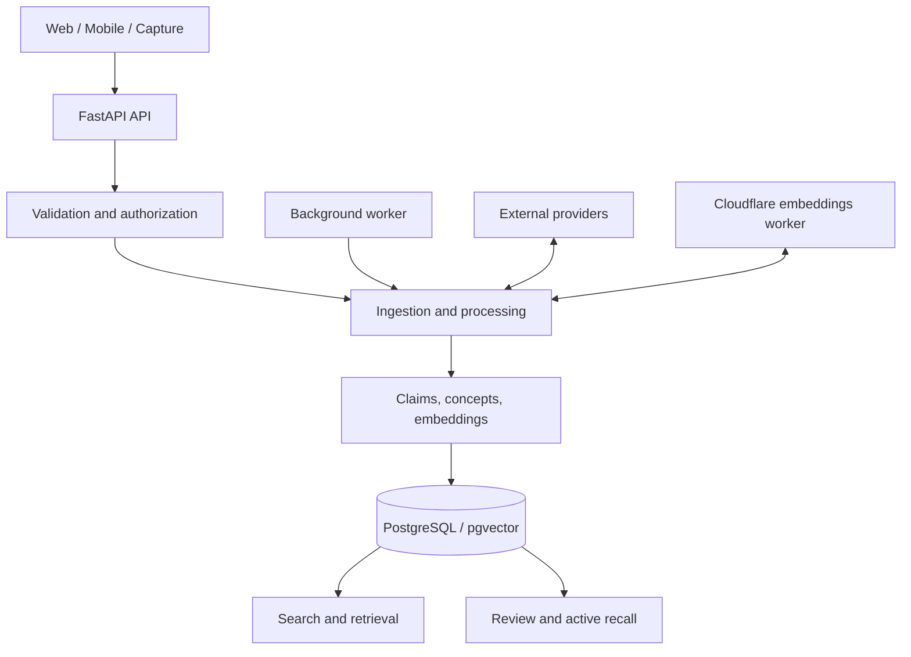

# Cognix Nexus — Architecture Overview

This document describes the repository's visible application boundaries and the intended high-level flow. The implementation and deployment configuration remain the source of truth; update this document when those change.

## Repository map

| Path | Responsibility |
|---|---|
| `apps/web-platform/frontend` | Next.js web client |
| `apps/web-platform/backend` | FastAPI API, processing workflows, persistence adapters, migrations, and worker runtime |
| `apps/mobile` | Expo / React Native client |
| `apps/web-platform/cloudflare/embeddings-worker` | Cloudflare Worker for embeddings-related operations |
| `scripts` | Production migration and verification utilities |
| `.github/workflows` | CI, production checks, CodeQL, release gates, and keepalive automation |
| `render.yaml` | Render service definitions and environment wiring |

## Conceptual data flow

The diagram is conceptual. It does not imply every provider or client is enabled in every environment.

## Trust boundaries

- **Clients are untrusted.** The API must validate input and derive identity from verified authentication context, not client-supplied owner IDs.
- **Provider credentials are server-side.** Do not expose service-role keys, OAuth refresh tokens, or provider secrets in browser/mobile bundles.
- **AI output is not canonical truth.** Preserve source references and review state; generated claims require appropriate human review.
- **External URLs are untrusted.** Fetching paths must retain scheme, destination, redirect, and response-size protections.
- **Durable state must remain durable.** Production workflows should fail clearly when required persistence is unavailable rather than silently switching to ephemeral storage.
- **Vault data is sensitive.** Follow the implementation's client-side encryption and local-storage boundaries documented in the security policy.

## Runtime surfaces

### Web

The Next.js application lives in `apps/web-platform/frontend`. It uses npm and the committed `package-lock.json`.

### API and worker

The FastAPI application lives in `apps/web-platform/backend`. The API and background worker are separate Render services in the current Blueprint. PostgreSQL is the durable production store.

### Mobile

The Expo application lives in `apps/mobile`. Its public configuration uses `EXPO_PUBLIC_*` values. Only publishable/anonymous client keys belong in the mobile bundle; service-role credentials must never be included.

### Embeddings worker

The Cloudflare worker lives in `apps/web-platform/cloudflare/embeddings-worker`. Secrets are provisioned through the Cloudflare secret mechanism, not committed to `wrangler.jsonc` or source control.

## Configuration and secrets

- Start from the closest `.env.example` for the application being run.
- Keep local `.env` files untracked.
- Configure production secrets through the hosting provider's secret manager.
- Do not copy production credentials into local development or CI.
- Treat values prefixed with `NEXT_PUBLIC_` or `EXPO_PUBLIC_` as public.

## Validation

The repository already defines automated checks under `.github/workflows`, including frontend, backend, mobile, worker, dependency, and security-oriented checks. Check the latest Actions run for the actual status; the existence of a workflow file alone is not proof that a check passed.

See [SECURITY.md](../SECURITY.md) for threat boundaries and production security gates.
